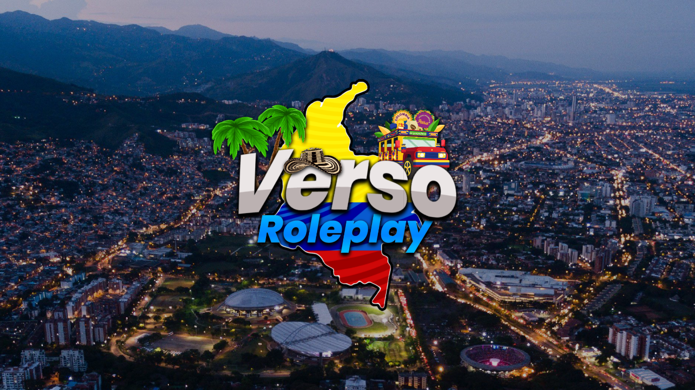

# ¿Quiénes Somos?

Nuestro proyecto nace con el propósito de impulsar una experiencia de Roleplay sólida, inmersiva y de calidad dentro de la plataforma Multi Theft Auto (GTA SA) en Colombia.

Buscamos construir un entorno donde cada jugador pueda desarrollar historias, convivir y disfrutar del servidor bajo un estilo auténticamente colombiano. A través de sistemas innovadores, scripts personalizados y mejoras constantes, trabajamos para ofrecer un espacio dinámico, seguro y pensado para el crecimiento de la comunidad.

Nuestro compromiso es hacer del Roleplay un lugar mejor para todos.

<figure><figcaption></figcaption></figure>

<figure><figcaption>
Dueño, Creador Y Titular Del Proyecto: AgogoMTA
</figcaption></figure>

