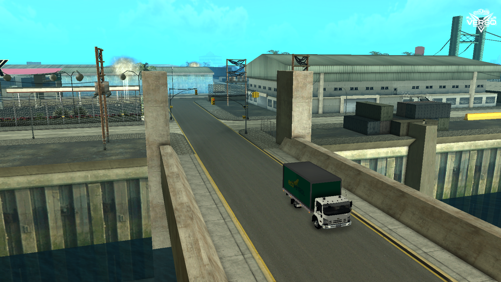
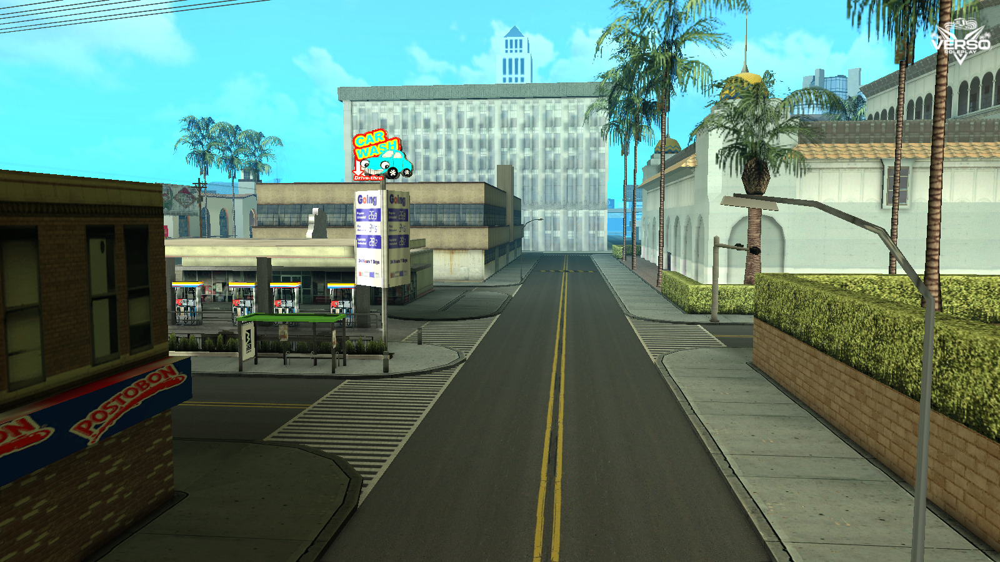

# Durante Rol (Pag.11)

1. El rol se cancelará por alguna de las siguientes dos razones: <mark style="color:green;">ambas partes quieran cancelarlo</mark> (confirmado por algún líder o directivo de cada facción) <mark style="color:green;">o que el rol complete 1 hora o más desde su inicio</mark> (solo puede ser cancelado por un encargado o superior con pruebas del tiempo). Si se cumple el tiempo, los dos bandos tendrán que retirarse en un plazo máximo de 5 minutos
2. Si un jugador muere durante un rol, aunque sea curado o reciba un rol de "recordar", <mark style="color:red;">no podrá volver a participar en el mismo rol.</mark> Deberá tirar /crack y permanecer en ese estado hasta que finalice el rol.  En caso de un enfrentamiento contra la ley en donde conlleva a un rol de encarcelamiento, Si terminado este rol no sobreviven más de la mitad de oficiales presentes no se podrá realizar el encarcelamiento, el rol se tendrá que dar por terminado y todos procederán a abandonar la zona. <mark style="color:orange;">En base a esto si el rol es en fabrica los elementos fabricados se tendrán que eliminar \[se tomarán como si hubiesen sido confiscados].</mark>
3. Se encuentra <mark style="color:red;">prohibido</mark> el uso de chats de voz <mark style="color:red;">(Discord, TeamSpeak, Skype y similares)</mark> para las comunicaciones dentro de rol. Se debe usar <mark style="color:green;">obligatoriamente</mark> el ítem de radio o chat faccionario. En caso omiso se tomará como <mark style="color:green;">MG</mark>.
4. Para que una facción reciba una advertencia durante un rol, se deben cometer 4 o más antiroles, Sin importar la cantidad de miembros que los hayan cometido.
5. Está prohibido <mark style="color:green;">cualquier tipo de provocación o comportamiento irrespetuoso</mark> durante el desarrollo de un rol, sin importar quién resulte ganador. Esto incluye, entre otras conductas, tomar fotografías con cuerpos abatidos con fines de burla o humillación, reproducir música a alto volumen para provocar, o utilizar expresiones destinadas a ridiculizar o menospreciar a quienes hayan perdido el rol.
6. Durante algún enfrentamiento u rol relacionado, no está permitido llamar a un médico antes de que el misma haya terminado.
7. No está permitido iniciar tiroteos ni realizar emboscadas <mark style="color:green;">en zonas de alta circulación o de fácil acceso</mark> para otros ciudadanos, como calles principales, inmediaciones de tiendas, negocios o empresas. Este tipo de acciones deberá llevarse a cabo únicamente en lugares más aislados y adecuados para ello, como callejones, estructuras abandonadas o zonas alejadas, evitando en todo momento involucrar a terceros ajenos a la situación.

_Ejemplos de lugares <mark style="color:red;">**no permitidos:**</mark>_&#x20;

<mark style="color:$info;">Por estas zonas transitan y trabajan muchos jugadores. Un tiroteo allí podría interrumpir sus actividades e involucrar a personas ajenas al rol.<mark style="color:$info;">

<figure><figcaption></figcaption></figure> <figure><figcaption></figcaption></figure>

<figure><figcaption></figcaption></figure>

8. Al ser abatido dentro de algún enfrentamiento u rol relacionado, el jugador deberá olvidar todos los acontecimientos de la misma y, obviamente, <mark style="color:red;">**no podrá volver a integrarse.**</mark>
9. Durante cualquier tipo de enfrentamiento u rol relacionado, no estarán permitidos los tiroteos entre jugadores dentro de vehículos; es necesario que ambos estén de pie para iniciar el tiroteo.
