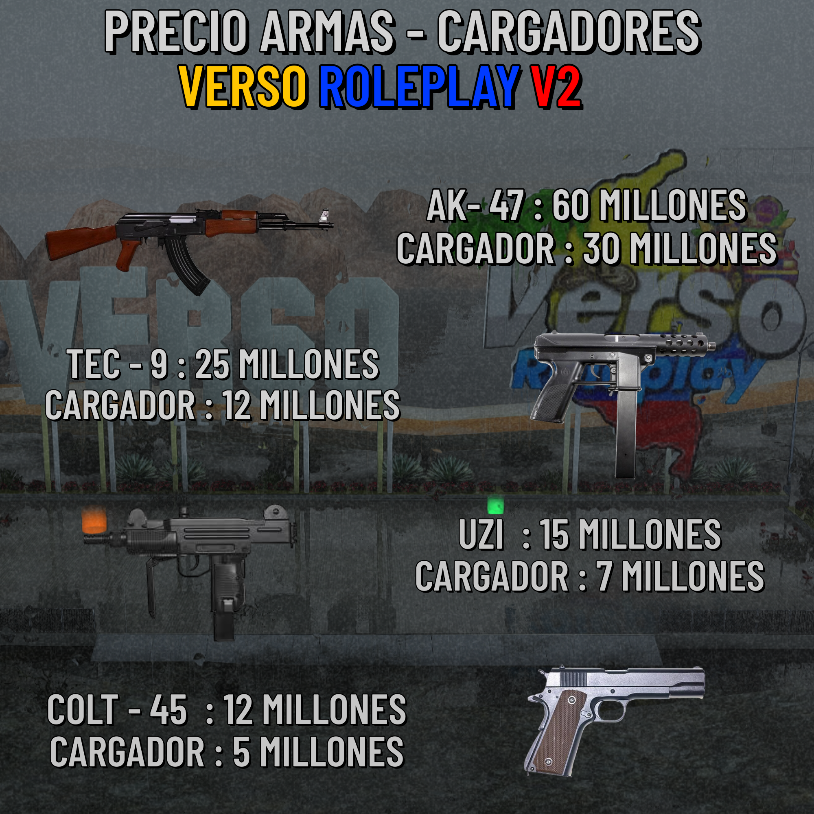

# Organizaciones Ilegales (Pag.6)

### Importante

1. Es obligatorio otorgar acceso al equipo de staff al servidor de Discord de la facción, permitiendo su supervisión interna mediante el acceso a los canales de interacción entre sus miembros.
2. La administración de cada facción <mark style="color:green;">será responsable del comportamiento de sus miembros</mark> dentro de los diferentes roles que realicen. Las infracciones cometidas por integrantes podrán derivar en medidas contra la facción si reflejan falta de control interno.
3. Toda persona vinculada a una facción ilegal <mark style="color:green;">no podrá realizar</mark> acciones delictivas como civil o integrante de grupos/bandas o pandillas externos/as, debiendo representar el rol de su organización y usar su respectivo uniforme en acciones operativas.
4. Toda facción deberá utilizar sus <mark style="color:green;">vehículos faccionarios</mark> en acciones operativas o delictivas, no pudiendo emplear vehículos civiles o externos para representar actividades propias de la organización.
5. En tiroteos <mark style="color:green;">no vinculados a roles organizados mediante normativa,</mark> el enfrentamiento no se considerará finalizado por la ausencia momentánea de oponentes, pudiendo integrarse refuerzos mientras el escenario continúe activo; solo cuando exista control real del lugar y cese la amenaza podrá darse por terminado, no siendo válido declararlo finalizado mediante conteos o suposiciones en medio del rol.
6. No está permitido usar vehículos para dar vueltas o moverse constantemente en medio de un tiroteo con el fin de evitar el combate; los vehículos solo deberán usarse para transporte, retirada o cobertura.
7. El <mark style="color:green;">chat faccionario</mark> deberá utilizarse exclusivamente para comunicaciones operativas, quedando prohibido su uso para quejas, provocaciones o consultas sobre el resultado de un rol, las cuales deberán realizarse mediante el comando correspondiente y esperar resolución del Staff.
8. <mark style="color:green;">**Zonas de Conflicto (Rancho y Fábrica de Armas)**</mark>
   \
   El rol deberá desarrollarse dentro de la propiedad, quedando prohibido disparar, posicionarse o campear desde el exterior o zonas elevadas; asimismo, será obligatorio permitir el ingreso y descenso de la facción contraria antes de iniciar disparos, contando la primera facción en llegar con 15 minutos de gracia antes de la entrada de otra.
9. No se permite <mark style="color:green;">provocar de forma reiterada a otra facción</mark> con el único fin de generar enfrentamientos o escalar conflictos sin un contexto de rol válido; toda interacción entre organizaciones deberá responder a una justificación coherente dentro del entorno y no a intenciones de hostigamiento o desgaste constante.


El incumplimiento de cualquiera de las disposiciones aquí establecidas podrá derivar advertencias faccionarios y/o la aplicación de sanciones por parte del Staff, las cuales serán determinadas según la gravedad de la falta, independientemente de si la acción fue ejecutada de forma individual o colectiva por miembros de una facción.



#### Apelaciones de advertencias


* Cuando se abre caso de apelación solamente está permitido que asista **Dueño** de la facción y un **Lider (Representante).**
* Solamente podrán entrar más personas si el staff encargado se lo permite. <mark style="color:red;">**(Nadie podrá saltar esta norma, ni miembros del staff implicados en dicha advertencia).**</mark>


#### Precios Oficiales De Armas


<figure><figcaption></figcaption></figure>


**Vehículos Permitidos Para Actos Ilegales**


1. Todo rol ilegal realizado por civiles deberá mantenerse dentro de un perfil acorde al contexto del mismo rol, quedando prohibido el uso de vehículos de lujo, deportivos de alta gama o modelos exclusivos para la ejecución de actividades ilegales.
